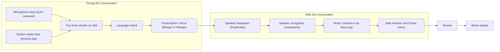
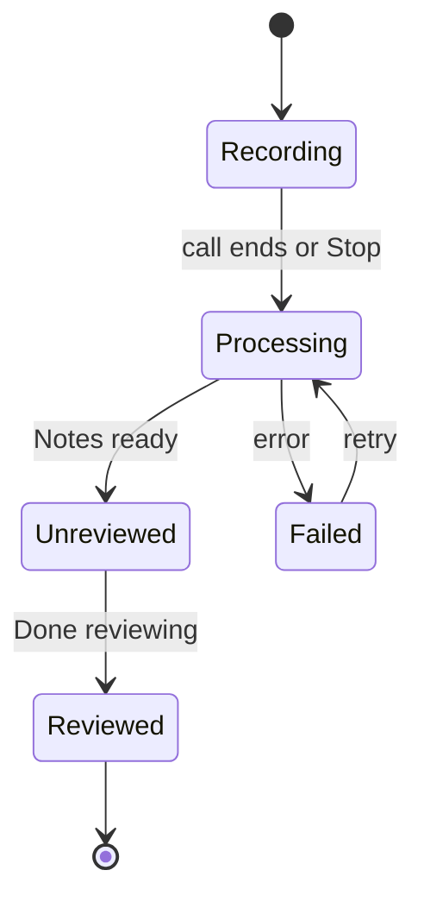

# Bekitzur v1 plan

Bekitzur is a native Mac app that records Conversations, transcribes them in Hebrew or English, recognizes who spoke, and writes English Notes for the user to review and share. Everything runs on the user's Mac. Vocabulary is defined in [CONTEXT.md](../CONTEXT.md); the hard-to-reverse decisions are in [docs/adr](adr/).

## Decisions

### Product
- For the user's team first, installable by anyone on other teams. Each copy is independent; copies never sync or share anything.
- Reasons to build: privacy, Hebrew accuracy, one tool for every kind of Conversation, and learning (Swift, on-device speech models, local LLMs).
- v1 is the core only, and it has to work flawlessly before extras are added.

### Platform
- Native Swift app ([ADR-0003](adr/0003-native-swift-app-built-from-scratch.md)) for Apple Silicon Macs with 32 GB of memory or more, on macOS 26 and later. Test on macOS 27 too.
- All processing on the Mac: no cloud speech, no cloud LLM, no server ([ADR-0001](adr/0001-all-processing-on-the-mac.md)). Models download once on first run; after that the app works offline.
- English UI. No telemetry.

### Capture
- The app records the microphone and the Mac's system audio as two tracks ([ADR-0002](adr/0002-capture-audio-on-the-mac.md)). This covers Teams, Slack huddles, phone calls relayed to the Mac through Continuity, and in-person Conversations.
- It must work with headphones, laptop speakers, and hybrid rooms, so speaker echo is removed from the microphone track and the microphone is never assumed to be only the user.
- Recording starts by hand (menu bar or keyboard shortcut) or when the user accepts the app's offer as a call starts. It stops when the call ends. It never records without a click.

### Transcription
- Runs in chunks during the Conversation, at low priority, with whisper.cpp and ivrit.ai's official GGML files. WhisperKit with the community Core ML conversion was less accurate on the [scripted read](#scripted-read-test).
- Each Conversation has one language, detected automatically. Hebrew uses ivrit.ai's Whisper large-v3-turbo fine-tune; English uses regular Whisper large-v3-turbo. Review offers "re-transcribe as Hebrew/English".
- NVIDIA's Nemotron 3.5 Transcribe (October 2026) replaces neither, for now ([research](research/nemotron-transcribe.md)): Hebrew is in its lowest tier, at about 21% word errors on FLEURS where ivrit.ai's fine-tune scores 18%, and it calls mixed-language speech a weakness. It's more accurate in English, but at 34 billion parameters it needs about 22 GB at 4 bits on a Mac, through a runtime whose Metal support isn't released, and it can't transcribe live. That fits a 48 GB Mac, where Metal lets one app use 37 GB, but hardly a 32 GB one, where the limit is about 21 GB. Worth a test on the scripted read on the 48 GB Mac once that runtime and NVIDIA's own model files are released, most likely for an English pass after the call.
- English words inside Hebrew speech are written in English letters.
- A Vocabulary (a built-in list of common tech terms plus the team's own terms, editable in Settings) fixes English terms after transcription: a Hebrew-letter word whose sounds match a Vocabulary term is proposed for rewriting in English letters, and Gemma confirms each proposal from its sentence. Nothing outside the Vocabulary is ever substituted. Pulled into v1 by the [scripted read test](#scripted-read-test), where English terms were the top error source; the same test showed a style prompt isn't needed.
- The Transcript is read-only.

### Speakers
- Speaker separation runs after the Conversation, on both tracks.
- Speakers are matched against stored Voiceprints: named automatically when the match is confident, offered as "Is this Dana?" when it isn't, and left as "Speaker N" otherwise. Naming a Speaker during Review creates or improves that Participant's Voiceprint.
- The user's own Voiceprint is enrolled at setup.
- No consent step: storing colleagues' Voiceprints is the user's responsibility. The People screen renames, merges, and deletes Voiceprints.
- Participants are not linked to Slack or Jira accounts.

### Notes
- Written in English by Gemma 4 26B-A4B through llama.cpp, after the Conversation and at low priority.
- Default sections: summary, Decisions, Action Items, Open Questions. Optional sections in shared Notes, each toggled in Settings: topic outline, Transcript, source links. Review always shows the Transcript and Sources.
- An Action Item has what, Owner, and due date. The Owner is whoever is named as doing the work, present or not, or an unnamed Speaker who said "I'll take it". Due dates are resolved against the Conversation's date.
- Due dates are resolved in code from the phrase the model quotes, and a second pass checks each Owner (both from the [LLM bake-off](#llm-bake-off-results)).

### Review
- Opt-out: everything is kept unless the user removes or edits it, then one "Done reviewing".
- A Conversation stays Unreviewed, and is flagged in the menu bar and the Conversations list, until its Review is done.
- Words the Vocabulary rewrote into English letters are marked in the Transcript, showing what was originally transcribed.

### Sharing
- Clipboard (rich text and Markdown), Markdown file with an optional default folder, macOS Share menu, Jira, and Slack, all in v1 and each switchable in Settings.
- Jira signs in through Atlassian's MCP server (OAuth 2.1 with PKCE, no secret in the app). What becomes a Jira issue is designed later.
- Slack is designed later.

### Retention and privacy
- A Recordings screen lists stored audio and allows deleting it.
- A Recording is deleted 3 days after its Conversation's Review (configurable).
- Unreviewed Conversations get reminders; their Recording is deleted after 30 days, with a warning first.
- Data relies on FileVault and is readable only by the user. No app-level encryption in v1.

### Distribution
- A zip file. Colleagues click "Open Anyway" once per version. No certificate, since none can be used on this Mac: builds are signed ad-hoc, with a designated requirement that names the bundle identifier instead of the build's hash, so microphone and system-audio permissions can survive updates.

### Later
Audio file import, search across Conversations, calendar titles and attendees, Apple Reminders, linking Participants to Slack and Jira accounts, the Jira issue design, and the Slack design. Newer models to test, checked in October 2026 with a test order for each: [speech and speakers](research/speech-models-2026-10.md), whose first pick, NVIDIA's Nemotron 3 Diarization, now separates Speakers, and [Notes](research/notes-models-2026-10.md), led by a longer context for the current Gemma.

## Architecture





Transcription happens while the Conversation is Recording. Processing covers speaker separation, speaker recognition, and Notes.

### Components

| Module | Responsibility | Built on |
|---|---|---|
| `BekitzurDomain` | Domain types: Transcript, Turn, Notes, Voiceprint | Swift |
| `BekitzurAudio` | Decoding audio files to 16 kHz mono samples | AVFoundation |
| `BekitzurCapture` | Two-track recording, chunk writer, call detection, Continuity calls | Core Audio process taps, AVAudioEngine voice processing |
| `BekitzurTranscription` | Language check, chunked transcription, silence filtering, word timestamps, Vocabulary rewrite | whisper.cpp, ivrit.ai GGML |
| `BekitzurSpeakers` | Speaker separation per track, Voiceprint store and matching, own-voice enrollment | FluidAudio: Nemotron 3 Diarization for who spoke when, pyannote community-1 for embeddings |
| `BekitzurNotes` | Notes extraction, long-Transcript chunking, date resolver, Owner check, quote check | llama.cpp XCFramework, Gemma 4 26B-A4B QAT GGUF |
| `BekitzurPipeline` | Runs the engine on a Recording, one model at a time; shared by the app and the CLI | the modules above |
| `BekitzurLibrary` | Conversations, lifecycle, storage, retention jobs | A folder per Conversation with JSON files |
| `BekitzurModels` | First-run model download, pinned revisions, SHA-256 checks | Hugging Face Hub |
| `BekitzurShare` | Clipboard, Markdown file, Share menu, Jira, Slack | AppKit, Atlassian MCP |
| `bekitzur` CLI | Runs the engine on audio files, for development and evaluation | the modules above |
| App | Menu bar control and windows: Conversations, Review, Recordings, People, Settings, first-run setup | SwiftUI `MenuBarExtra` |

Models and data live in `~/Library/Application Support/Bekitzur/`. Peak memory comes from one model at a time: Whisper during the Conversation, then FluidAudio, then Gemma 4.

### Repository layout

```text
bekitzur/
├── CONTEXT.md
├── docs/            plan, ADRs
├── Package.swift    Bekitzur modules and the bekitzur CLI
├── Sources/
├── Tests/
├── App/             Info.plist for the app bundle
├── scripts/         build-app.sh (build, sign, install), test.sh
├── eval/            scoring scripts for public datasets (no private audio)
└── spikes/llm-bakeoff/
```

## LLM bake-off results

From [spikes/llm-bakeoff](../spikes/llm-bakeoff): five synthetic Conversations with answer keys (a Hebrew team sync, an English 1:1, a Hebrew meeting that switches to English, a copy of the Hebrew sync with speech-recognition errors, and a 30-minute padded version of it). Model: Gemma 4 26B-A4B, quantization-aware 4-bit, served by Ollama's llama.cpp runner on an M4 Pro.

- Found every required Action Item (34/34), Decision (10/10), and Open Question (9/9). It didn't mistake any trap for an Action Item: jokes, wishful ideas, finished work, a reversed decision, and a cancelled offer were all left out.
- Owners: 31/34. All three misses are the same case: "let's ask Yossi to check the logs" was assigned to the person passing on the request.
- Due dates: 30/34. Weekday arithmetic is inconsistent even with a calendar in the prompt.
- Speed: reading 640 to 930 tokens per second, writing about 66 per second. A 16,000-token Transcript took 45 seconds, so an hour of Hebrew (about 35,000 tokens) should take about 1.5 minutes.
- Memory: 14.4 GB of weights plus several GB of working memory at a 32K-token context.
- Thinking mode is unusable for this task: it looped until the context was full (about 30,000 tokens) without answering.

## First recording test

A 23-second free-form memo (one speaker, Hebrew with English terms), transcribed with whisper.cpp on the M4 Pro:

- ivrit.ai turbo: no word errors and correct punctuation. "deployment" and "CI" came out in English letters, but "staging", the one term with an attached Hebrew prefix, came out as לסטייג'ינג.
- Regular Whisper turbo: one word error, no punctuation, and both "deployment" and "staging" in Hebrew letters. This confirms ivrit.ai for Hebrew.
- A prompt listing English words changed nothing. A style prompt (an example Hebrew sentence written with English terms in English letters, such as "אתמול עשינו deploy ל-staging, הרצנו CI ובדקנו את ה-pipeline לפני ה-release.") produced "ל-staging", exactly the target format.
- Side effects of the style prompt to check on the full scripted read: a stray comma at the start, and one 30-second segment instead of sentence-level timestamps.

## Scripted read test

Lines 1 to 39 of the script (4¼ minutes, 487 words, 69 English terms read), two readers around the Mac's built-in microphone, recorded as a compressed voice memo. Scored with [eval/score_asr.py](../eval/score_asr.py) and [eval/score_speakers.py](../eval/score_speakers.py).

| Setup | Word error rate | Hebrew words right | English terms in English letters |
|---|---|---|---|
| ivrit.ai turbo | 16.0% | 97.3% | 13 |
| ivrit.ai turbo + style prompt | 13.6% | 96.1% | 27 |
| ivrit.ai turbo + [Gemma post-processing](../eval/latinize.py) | 10.1% | 95.3% | 50 |
| ivrit.ai turbo + [Vocabulary sound match](../eval/match_vocab.py) | 12.5% | 93.9% | 44 |
| ivrit.ai turbo + Vocabulary sound match + Gemma verifier | 7.4% | 97.1% | 56 |
| Same, with looser matching (`--loose`) | 6.2% | 97.1% | 61 (63 counting image/images and alert/alerts) |
| Regular Whisper turbo | 19.7% | 92.9% | 15 |

- Hebrew is excellent; the remaining errors are almost all English terms, written in Hebrew letters or garbled (registry, routing layer, Rust).
- The style prompt helps only while whisper.cpp keeps earlier text as context; `-mc 0` drops the prompt, even with `--carry-initial-prompt`.
- Gemma post-processing without context invents wrong words for garbled terms (קרברוס became "kubernetes", הרנבוק became "remock"), so it isn't usable as is.
- Vocabulary sound match (consonant sounds against [a 250-term built-in list](../eval/vocabulary/built-in.txt) plus the team list) proposes substitutions; alone it also hits ordinary Hebrew words (תיקון as "token", אתמול as "html"). With Gemma as a verifier that sees the sentence and can only pick one of the proposed terms or reject, all 9 false matches were rejected, all ties were resolved (gateway or github, retry or retro, spike or spec), and no wrong substitution remained. Best setup: plain ivrit.ai with `-mc 0` (no style prompt) plus match and verify.
- Looser matching (one-sound differences for 4-sound terms, 2-sound terms, hyphenated word pairs such as שהטיים-אאוט) reached 61 of 69, or 63 counting singular-for-plural, with Hebrew untouched. What's left is garbled in the audio (registry, service, Rust, on-call, a mangled release).
- whisper.cpp vs WhisperKit, same ivrit.ai turbo model (official GGML vs community Core ML conversion): whisper.cpp 16.0% word error rate and 97.3% Hebrew words right in about 10 seconds on the GPU; WhisperKit 20.9% and 95.1% in about 15 seconds on the Neural Engine, after a one-time 4-minute model preparation. Against what was actually said, WhisperKit misheard 7 of the colleague's Hebrew words and whisper.cpp 1. WhisperKit also wrote out the reader's repetitions, which whisper.cpp smoothed over. Chosen: whisper.cpp. If transcription during calls competes with Teams for the GPU, try whisper.cpp's Core ML encoder, which moves only the encoder to the Neural Engine.
- Verifier lessons (from a bug in the test script): WhisperKit returns one long line, so every item carried the whole transcript, the request overflowed the model's context, Ollama silently cut it, and wrong terms were applied. The verifier now sends about 60 characters around each word, in batches of 20, requires each answer to echo its word, and fails loudly on truncation. Even then, loose matching turned one garbled fragment into a plausible wrong term (סטרי, actually registry, became "stream"), so Review should mark rewritten words and show what was originally transcribed.
- Safety rule learned: a substitution must never absorb a real word. A space-separated pair העונקו לא matched on-call, swallowed the negation לא, flipped the sentence's meaning, and got past the verifier. Pairs are now matched only when hyphenated, and ties keep the longest prefix so ו and ה survive.
- Reader effect ([eval/reader_errors.py](../eval/reader_errors.py), comparing where ivrit.ai and regular Whisper agree): reading slips were about 1.5% of Hebrew words for each reader, and against what was actually said ivrit.ai got 390 of 392 Hebrew words right. A few English terms were likely unclear in the audio (both models garbled registry, service, and on-call). Writing recognized English terms in Hebrew letters happened for both readers alike (2 of 17 and 10 of 50 in English letters), so it's model behavior, not reading.
- Transcription speed: 4¼ minutes of audio in about 10 seconds.
- Speakers: FluidAudio's offline pipeline found exactly 2 speakers, in about 7 seconds (plus a one-time 82-second model compile). Voiceprints from 30-second voice samples named both correctly for 99.4% of speech time, with wide margins (0.93 vs 0.12 and 0.78 vs 0.07). Two clearly different voices is the easy case; meetings with more and similar voices still need testing.

## English terms from the speech recognition itself

Can recognition get English terms right, rather than a rewrite against a term list afterwards? Three tests on the scripted read (72 terms) and the team meeting, October 20. Today's baseline: ivrit.ai alone 17.0% word errors and 15 of 72 terms in English letters; with the Vocabulary, 8.8% and 56.

- **A prompt** (`bekitzur transcribe --prompt`). whisper.cpp puts a carried prompt first in each 30-second window and fills the rest of the text budget with earlier transcription, so a budget of the prompt's tokens plus one carries the prompt alone (with `-mc 0` there was no prompt at all). A style sentence naming the team's term and no term from the script ("אתמול עשינו deploy ל-staging, פתחנו PR ב-GitHub ועשינו merge ל-branch של [project] לפני ה-demo.") took ivrit.ai from 16 to 31 terms in English letters and from 18.1% to 13.6% word errors, with Hebrew unharmed (scored with whisper-cli). With the Vocabulary after it the gain is gone (8.8% against 9.7%, 55 terms against 57): the prompt writes some terms in misspelled English letters ("flacky", "Gatway", "Rottinglyer"), which the Vocabulary can't repair since it reads only Hebrew letters; it also dropped one word, and the style sentence without the project's name turned gateway into "GitWay" twice. In the team meeting, with two of the team's project names in the sentence, words in English letters went from 43 to 80, among them flag where it had no prefix, but elastic also came out as "lastic", one PubSub disappeared, and expect, tests, and skill stayed in Hebrew letters.
- **Scoring against the audio** (`bekitzur audio-check`, [eval/audio_check.py](../eval/audio_check.py)). Whisper scores each candidate word's sentence as transcribed and with each matched term, by feeding the text through its decoder. Choosing between terms works: 8 of 8 on the scripted read (gateway or github, spike or spec), and flag above plugin at all 8 places in the team meeting. Choosing between a term and the Hebrew-letter word doesn't: both Whisper models prefer Hebrew letters for these words, so right terms scored from 36 below to 24 above the transcribed word and wrong ones overlapped. Deciding by audio alone reached 40 to 48 terms at the cost of Hebrew words, and as a veto on the verifier it dropped right terms (45 at best). Plugin, alone, can't be rejected for פלאג either: it scores like the right terms tests, pubsub, and expect. About 2 minutes for the team meeting's 16 minutes, unoptimized.
- **A second run forced to English** ([eval/english_run.py](../eval/english_run.py)). Plain Whisper turbo ignores the translate task, but forced to English it writes a rough translation that keeps English terms in English. Its words within 3 seconds of a Hebrew-letter word, matched by sound, are candidates with no list behind them. In the team meeting they included flag, skills (where the Vocabulary had scale), emulator (master), offboarding (routing), business (license), Microsoft, extension, dependencies, and three internal product names; they missed handler, Parser, tenant, and PubSub. On the scripted read, whose terms the built-in list was built from, they found fewer right terms than the Vocabulary (27 against 33) but gave ordinary Hebrew words far fewer wrong candidates (13 against 78). Ordinary words still get some (אבל as "able", ליצור as "sure"), and the English text falls into repetition loops, so these candidates need the verifier too. About a minute for 16 minutes of audio.
- **Both sources, the verifier deciding** (`bekitzur english-terms`). On the team meeting with the list as it was before that day (no flag, inventory, elastic, pubsub, or expect), rewritten words went from 44 to 86: flag instead of plugin in all four spellings, inventory, elastic, expect, emulator, skill, business, adoption, and instruction. New errors came with them: names (Dina, Gavri), the English run's misspellings (Pubsa, Bandler, GOLOMO), and Hebrew words (מהצד as "side", הסינכרוני as "asynchronous", דוקומנטציה as "document"). On the scripted read, terms went from 54 to 56 and word errors from 9.2% to 9.0%; with no list at all, the English run alone reached 46 of 72 (the recognizer alone: 15). Letting the audio choose between competing terms made it worse (scale over skill, master over emulator, policy over flaky). Keeping only English-run words that are lowercase entries in the system dictionary (/usr/share/dict/words) or Vocabulary terms removed the names and misspellings, and also Microsoft and offboarding.
- The verifier is the weak point: a borderline word's answer changes with whatever else is in its batch of 20. With the dictionary filter, it rejected flag for three of the four spellings of פלאג, offered next to plugin exactly as before. Next: show the verifier what the English run heard around each word, and make each answer independent of its batch.

## Phases

Each phase ends with acceptance criteria that are checked before moving on.

### Phase 0: Setup
- Swift package with the modules above and the `bekitzur` CLI. Swift 6.4 from Command Line Tools builds everything, including the app; Xcode isn't needed.
  - SwiftUI's `@State` is a macro whose plugin ships only with Xcode, so the app uses `@ViewState`, an alias for the property wrapper underneath.
  - SwiftPM doesn't pass Swift Testing's macro plugin to the compiler with Command Line Tools alone; `scripts/test.sh` adds it.
- Signing: ad-hoc, with the designated requirement `identifier "app.bekitzur.mac"` (see `scripts/build-app.sh`). An ad-hoc signature normally identifies the app by the build's hash, which makes macOS ask for permissions again after every build. Whether macOS honors the identifier requirement is checked at the first rebuild after you approve the permissions: the app writes its microphone permission to `~/Library/Logs/Bekitzur/Bekitzur.log` at launch.

### Phase 1: Engine on audio files
The CLI takes a microphone track and a system-audio track (or one mixed file) plus a Conversation date, and writes the Transcript and Notes as JSON.

1. **Transcription.** Run ivrit.ai Whisper turbo two ways, WhisperKit with a Core ML conversion (ours, via whisperkittools, or the community build) and whisper.cpp with ivrit.ai's official GGML files, and keep the more accurate one. Force the language, filter silence, and don't carry text between windows, which prevents Whisper's hallucination loops. Add the language check with regular Whisper. Then rewrite Hebrew-letter words that match a Vocabulary term by sound into English letters, keeping the Hebrew prefix (ה-gateway), with Gemma verifying each proposal in context (see [scripted read test](#scripted-read-test)).
2. **Speakers.** FluidAudio offline separation per track; Voiceprints from its speaker embeddings; matching thresholds for named, "Is this…?", and unknown; own-voice enrollment.
3. **Notes.** Port the bake-off prompt and schema to llama.cpp with a JSON-schema grammar. Add the date resolver, the Owner check pass, and the quote check. Single pass up to about 24,000 tokens, chunked extraction with merging above that. Extend the bake-off harness to run against the CLI, and add an hour-long (about 35,000-token) Hebrew test.
4. **Scripted read.** You (ideally with a colleague) read the Hebrew test Transcript aloud; the result tests English terms and speaker naming on real voices.

Status (October 19):
- Built: the `bekitzur` CLI, a Swift package that builds with Command Line Tools alone.
  - `transcribe`: whisper.cpp with ivrit.ai's GGML; on the same audio its output is identical to whisper-cli's.
  - `enroll` and `speakers`: FluidAudio separation and Voiceprints; named both readers of the scripted read with the same similarities as the evaluation (0.93 and 0.78), 99% of speech attributed correctly.
  - Speaker attribution, after the two-person call (a 9-minute voice memo of an English Teams call): pyannote put the user's quick replies at the start (a greeting, "I'm good, thank you") in the other person's voice, and none of its settings for short speech changed that. Now Sortformer gives the timeline and pyannote the embeddings, matched by overlap, with pyannote's timeline above four voices (Sortformer's limit). Whisper's segments are split at Speaker changes using word times from DTW alignment; Whisper's own token times were up to a second off. The call's opening is now right, and the scripted read went from 99% to 100% of speech attributed correctly. DTW needs flash attention off, which makes transcription about 15% slower.
  - The voice-memo meeting (32 minutes, Hebrew, three people, recorded as a voice memo near the user): the two colleagues were faint, and every voice scored 0.75 to 0.83 against the user's Voiceprint, so embeddings couldn't tell them apart. pyannote heard two voices and Sortformer four, three of them mixtures; evening out the loudness first didn't help either. When the user says how many people spoke and pyannote hears a different number, pyannote is now held to that number and its timeline is used; held to three, it matched the user's account of who spoke at 3:30 and 3:50. A confident Voiceprint match must now also beat every other Speaker's similarity to that Participant by the margin, so a recording like this one gets "Is this Dana?" instead of a wrong name. Both separators label voices "S1", "S2", …, which had merged Sortformer's unmatched voices into matched ones; fixed.
  - The first marks from listening back (the allocation discussion, 41 seconds): all four were a new Speaker's first words given to the one before. Where Sortformer's turns overlap because one runs on as the next starts, a word now goes to the speaker who started last (a short reply inside a long turn keeps the old rule), and no word counts as longer than 0.6 seconds, since a word's last token can be timed seconds late. All four moved to the user and nothing else changed; the call, the scripted read, and the voice-memo meeting kept their results.
  - The team meeting marks (16½ minutes, Hebrew, three people, imported): a fourth voice that only Sortformer heard, for 4 seconds at the end, became "Speaker 4". A voice without a pyannote match is now kept only if it speaks at least 5% of the Conversation's speech, between 3 and 10 seconds; otherwise its words go to the Speakers around it, and the same threshold applies when counting pyannote's voices. A 0.4-second Sortformer turn inside another Speaker's turn ("אז" at 0:53) still wins: dropping such turns would have moved about 22 words the user listened to and left unmarked. The call, the scripted read, the allocation discussion, and the voice-memo meeting kept their results.
  - The weekly sync (19 minutes, Hebrew, a call with three people on the other side): two of them were one Speaker, though they sound nothing alike. pyannote told them apart, their embeddings 0.16 alike where the same voice scores 0.78 to 0.93, but Sortformer heard two voices on that side, and matching voices one to one gave the second person's embedding to a one-second Sortformer voice. When Sortformer hears fewer voices that count as people than pyannote, pyannote's timeline is now used, as above four voices: two Speakers who are one person can be joined by naming them alike, but two people in one Speaker can only be fixed word by word. Of the other Conversations, only one call changed, whose biggest Speaker was two voices 0.20 alike; the rest kept their results. Separate Speakers again no longer needs a different number of people, so Conversations from before can be separated again.
  - NVIDIA's Nemotron 3 Diarization took over from Sortformer as the timeline model, after the [model research](research/speech-models-2026-10.md): it tells apart eight voices instead of four, and FluidAudio already shipped it, in the offline profile for whole recordings (193 MB, downloaded once). Compared on every Conversation and the scripted read, each separated as the app does: on the weekly sync's other side it heard the three people pyannote did, so its timeline was kept and the 6-second voice the fallback left behind went away; in the 43-minute in-room conversation it heard the two voices pyannote did, where Sortformer split the user's into 432 and 423 seconds; the other Conversations got the same Speakers within a few seconds, and the scripted read stayed at 99.2% of speech attributed to the right reader. It replaces Sortformer completely: new installs download only Nemotron's model, and an install from before uses Sortformer's only until Nemotron's is downloaded, at the first Conversation processed after the update, then deletes it (230 MB), as it does at launch when Nemotron's is already there. eval/score_call_sides.py needed `audioop`, gone since Python 3.13, so it now measures loudness itself.
  - Recording setup matters more than any setting: calls recorded by Bekitzur put the other side on its own full-level track, and in a room the microphone belongs in the middle of the table.
  - A call's Speakers are separated per side. The first long call recorded in the app (52 minutes, English, on laptop speakers) came out unusable: the microphone heard the other side as loud as the system audio did (within a decibel or two, second by second), about 10 dB louder than the user, and separating the summed tracks put a third of the speech with a voice from the other side, measured against the tracks themselves (system-audio speech is the other side, microphone-only speech the user's). Silencing the microphone while the system audio had speech didn't change that (32%), so it wasn't the echo alone, and the other side had only two or three voices. Separated on its own, the system audio gave the other side's voices, and the microphone with the other side's speech silenced (Silero, padded 0.3 seconds) gave exactly one voice, the user. Recordings with less than 10 seconds of speech in the system audio, like meetings in a room, are separated as before. On that call, speech with a voice from the other side went from 32% to 0.7%. Words the user said while someone on the other side spoke went to that person: on a November 2 test call, two short replies said over the other person. The microphone now stays on where the user talks over them. The speakers' copy is predicted from the system audio frequency by frequency, through each frequency's echo path fitted to the call, and a moment is the user's when what's left of the microphone is 15 dB above the predicted copy, 25 dB above the room's noise, and louder than the other side itself, in most of five 16 ms frames; a single level for the copy couldn't do it, since 20 ms at a time the microphone strayed 7 to 13 dB from any one level while only the other side talked. Across 11 calls, only words that had gone to the other side moved, all to the user: 15 of the November 2 call's 190 words, both replies and four more the user hadn't fixed ("יש לנו ויקלי", followed by the user's "בשביל זה" and the answer "אני לא אעשה את הספוילר"); 24 of 2,094 on October 28, mostly short replies like "ברור, ברור"; 5 of 6,978 on October 21; and none on five calls. A few were single words inside someone else's sentence, which may be the user saying something over them that the Transcript left out.
  - Voices, not inputs. A room test on November 2 (34 seconds, two people talking over each other on one microphone) worried that tying Speakers to the input they came through would fail rooms, Zoom, and hybrid meetings, so a call's tracks now each go through what a room goes through, and inputs only say where a voice was heard. Voices that only the timeline model heard get a fingerprint from pyannote on that voice's own speech, its stretches of 0.4 seconds or more where no other voice talks, put together, so they compare with the Voiceprints: in the room test pyannote heard one voice where Nemotron heard two, and the second couldn't be recognized later. The speakers' copy of the other side is taken out of the microphone instead of silencing it (`EchoCanceller`): predicted from the system audio frequency by frequency, from its last eight 16 ms frames through gains fitted by least squares where the other side talks, then fitted again on the moments the first fit explains, since the others hold the user; subtracted (7 to 10 dB on three calls); what's left of it turned down where nothing louder is left; and the microphone put back together. What's left is quiet but still a voice to a speaker separator (42 seconds of the other person on November 2), so where the other side talks the microphone is silenced except within 50 ms of speech of its own, 9 dB above what's left of the copy and 20 dB above the room's noise. Each input is separated on its own, and a microphone voice whose fingerprint matches a system-audio voice at 0.55 or more is that person, someone in the room who also joined the call or what's left of the other side: on four calls, voices left from the other side matched at 0.64 to 0.96, and the user matched no one on the other side above 0.36. A call's tracks are also transcribed each on its own once it ends, instead of using the live Transcript of both summed, which wrote only the louder of two people talking at once; each word goes to the voices heard in its own track. Microphone words are left out where they repeat the system audio's within 0.4 seconds next to another that does, where they're more than 0.25 seconds from the microphone's speech (speech recognition wrote "תודה רבה לך, אדוני היושב-ראש" into the silenced microphone on November 2 and into a quiet moment on November 1), and where they go to a voice from the system audio, whose words that track already has. Words written went from 6,978 to 7,054 on October 21, 2,094 to 2,258 on October 28, 439 to 453 on November 1, and 190 to 208 on November 2, where the added words were the ones said under someone else's; rooms came out as before but for two or three words moved between Speakers. Transcribing both tracks adds about 2 minutes after a 19-minute call and 4½ after a 52-minute one, the microphone, mostly silence, taking longer than the system audio (159 seconds against 96); the echo removal takes 1.5 and 8 seconds. Still open: 7 short microphone words on November 1 have no Speaker, where no voice was found that short.
  - Naming a Speaker averages its voice into that person's Voiceprint, so naming that call's mixed Speakers broke three Voiceprints: the user's matched a voice from the other side and none of the user's earlier Speakers (0.19 to 0.27), and a colleague's was mostly the user. The user's was rebuilt from their Speakers in seven earlier Conversations (0.68 to 0.96 against each), and the other two were removed to be named again.
  - `notes`: Gemma 4 through llama.cpp with a JSON grammar, and due dates resolved in code from the quoted phrase.
  - `process`: all three in one process, one model loaded at a time; the 4¼-minute scripted read went from audio to Notes in 43 seconds.
- Notes on the five bake-off Conversations: 34/34 Action Items, no traps, Decisions 10/10, Open Questions 9/9, Owners 31/34, due dates 33/34 (Ollama: 30/34).
  - Gemma's 25 sliding-window layers see only the last 1,024 tokens, but llama.cpp keeps a full-size cache for them by default (6.4 GB at 32,768 tokens), which only rewinding the context needs. Nothing rewinds it, so the cache now holds the window: each loaded model takes about 1.5 GB beyond the model file instead of 7.5 GB. The bake-off scores came out the same, and four of the five Notes were identical; the long one differed in three borderline phrases, as likely right as before. Questions gave the same answers.
- The Vocabulary rewrite, ported from [eval/match_vocab.py](../eval/match_vocab.py) into `BekitzurVocabulary` and run in the pipeline for Hebrew between Speakers and Notes, with the same language model load. On the scripted read it finds the same 97 candidate words as the prototype; with the verifier, the word error rate went from 17.0% to 8.8–9.0% and English letters from 15 to 55–56 of 72, every rewrite correct. On the voice-memo meeting it rewrote 205 of 4,007 words (Kafka, topic, partitions, consumer, SQS…); missing terms showed up as near-misses (topic as traffic, Confluent as confluence), so messaging terms joined the built-in list (then 309, generated from eval/vocabulary/built-in.txt by scripts/generate-built-in-vocabulary.py). Plural Hebrew words keep the plural (פרטישנים → partitions).
  - The verifier answers every word, keyed by its id, and the grammar allows each answer only "none" or that word's own candidates. Repeating each Hebrew word (the prototype's safeguard) made answers four times longer; with no key, answers slid onto neighbors; asked to list only the terms, it missed clear terms (43 of 72 instead of 56). It now takes about 20 seconds for the scripted read and 80 for the voice-memo meeting's 32 minutes. Borderline words (one or two per Conversation) can come out differently between runs.
  - Grammar-constrained generation checks only the likeliest token against the grammar, and the whole vocabulary only when that token doesn't fit; greedy output is identical (checked on two bake-off Conversations) and twice as fast, which is most of the old gap to Ollama.
  - The team meeting marks showed learning gone wrong. A correction of a project's name after the prefix "ב-" saved "ב", only a prefix, as a spelling of that name, and Update Notes then rewrote the ב in front of other English words ("ב-GRPC" became the project's name followed by "-GRPC"). A spelling now needs at least two sounds, and older ones are dropped when the Vocabulary loads. Corrections that keep the prefix glued to the term ("הInventory", "בPubSub") now teach the spelling too. A term that's already plural isn't pluralized again ("testses"). Missing terms joined the built-in list (now 317): without flag, פלאג became plugin. Update Notes ran the Vocabulary over the stored Transcript, where a word rewritten earlier is no longer in Hebrew letters, so a spelling taught later reached only the corrected word and a removed spelling kept its rewrites; the Vocabulary now always starts from what was transcribed. Run again on the reprocessed team meeting, 81 of its 85 rewritten words came out the same; the other four were borderline (סקיל as scale, where the context suggests skill, which isn't in the Vocabulary).
- Remaining: two people talking at once into one microphone, which needs a model that separates voices, and none runs on this Mac yet (FluidAudio has none, and pyannote's runs only in PyTorch); the Owner check pass (the relayed request is the only Owner error left); an English check and duplicate removal, since Decisions have come back as the Hebrew quote instead of English text, once twice in the same Notes; a faster Vocabulary check for long Conversations, and near-misses when the right term isn't in the Vocabulary (הדר as header); an hour-long Hebrew test.

Acceptance:
- Hebrew word error rate on a sample of ivrit.ai's eval-d1 set is within 1 point of ivrit.ai's published 5.3%.
- In the scripted read, at least 90% of English terms come out in English letters, and every Speaker is either named correctly or left unnamed. A confident wrong name counts as a failure.
- On the five bake-off Conversations: every required item found, no traps, all Owners and due dates correct, valid JSON every time.
- One hour of audio: transcription within 8 minutes, speaker separation within 1 minute, and Notes within 3 minutes on the M4 Pro; peak memory under 22 GB.

### V1 for daily testing
Pulled forward from Phases 2 and 3 so you can test on real Conversations: a menu bar app that records and then writes Notes after the call. Opening the app shows its main window, and it has a Dock icon while a window is open; on a notched MacBook with a full menu bar, the menu bar icon can end up hidden, and the window's toolbar starts and stops recordings too. `scripts/build-app.sh` builds `Bekitzur.app` and installs it in `~/Applications`. `scripts/package.sh` builds it the same way and packs it with `scripts/install.sh` into `build/Bekitzur.zip`, the file to hand someone, without installing it. The icon, a speech bubble holding a waveform, and the menu bar's matching template images (with a dot while a Conversation waits for review) are drawn by `scripts/make-icon.swift` into `App/Resources`, which both scripts copy into the app; it's a classic .icns, since macOS 26's layered icons need Xcode to compile, and macOS shows it without the gray frame it puts around icons that don't fill the rounded square.

Status (October 19):
- Recording: the microphone (AVAudioEngine, mixed down to mono) and everything the Mac plays (a Core Audio process tap, which needs only the system audio permission), as two AAC tracks in the Conversation's folder.
- Processing after Stop, one Conversation at a time: the two tracks are mixed, then transcription, Speakers, and Notes run as in the CLI. Conversations interrupted by quitting are processed on the next launch. A "Notes ready" notification opens the Conversation.
- Review: Notes with Owners, due dates, quotes, and Sources (hover a Source to see the turn); Transcript laid out right to left for Hebrew; Speakers, where naming one updates the Transcript, Owners, and Notes text and remembers the voice; "Is this Dana?" for possible matches; "Done reviewing"; Copy Notes as Markdown; write Notes again, or transcribe again in the other language.
- Settings: your name and a 30-second voice sample, the People list with Forget.
- Listening back with the Transcript: a player under the Transcript (space bar, scrubber, 0.75× to 2×) highlights the word being said and scrolls with it, and Sources in the Notes play from their turn. Clicking a word marks it wrong, F marks the word just played, right-clicking a word takes what was said or marks it as said by someone else, and right-clicking a Speaker marks the line's Speaker wrong. Marks and how far the user has listened are saved in the Conversation's flags.json, so accuracy can be measured on real Conversations (unmarked words before that point count as right). "Write Notes again" keeps the Transcript and its marks; transcribing again drops them.
- Marks fix the Transcript: a word given what was said shows it (green underline, what was transcribed on hover), and a word or line marked "Said by …" another Speaker moves to that Speaker's line (orange). The stored Transcript stays as transcribed, so accuracy can still be measured. When the Notes predate the fixes, the Notes tab offers Update Notes, which checks the English terms and writes the Notes again from the fixed Transcript without the audio. Naming a Speaker carries over to the marks.
- The Vocabulary learns from fixes: an English term typed for a word transcribed in Hebrew letters saves that spelling (without its prefix) and the term, so later Transcripts get it right without asking the language model. Settings lists the team's terms and the learned spellings, to add or remove. Words the Vocabulary rewrote have a dotted underline, with what was transcribed on hover.
- Import of recordings made elsewhere, like voice memos: the toolbar's Import button (with how many people spoke), dropping files on the Conversation list, or Finder's Open With. A Conversation is dated from the recording's metadata when it has a date, so due dates count from the day it was recorded. The 32-minute Hebrew voice-memo meeting took 2½ minutes, and the user was named from the Voiceprint saved in the English call.
- A warning on the Conversation when the system audio track is silent and the permission isn't granted. With the permission, silence means nothing played, as in a room: a 3-minute conversation in a room had been warned about.
- The main window (above the Conversation list) and the menu bar say which permissions macOS hasn't given, microphone, system audio, or notifications, each with a button that asks for it or, once denied, opens its page in System Settings. They're checked at launch, when either shows, and when the app becomes active, as it does coming back from System Settings. System audio has no public status and a tap without it records silence, so it's read from TCC's private interface: in one process it answered 1 and 2 where the microphone's public status said denied and not asked, and 0 for Bekitzur, whose recordings have system audio. The first check found notifications denied, so "Notes ready" had never shown.
- A live Transcript while recording, about half a minute behind, without Speakers or English terms; it stays on screen while the Notes are written. Starting a recording selects its Conversation, and a timer in the same form as the Transcript's times shows how long it has been going (in the live view, the Conversation list, and the menu bar, whose recording line opens the live view). Both tracks are copied as they're recorded, mixed at 16 kHz, cut into chunks of 20 to 30 seconds at pauses, and transcribed on a low-priority thread, so the recording never waits on it. When the recording stops, the last chunk is transcribed and processing starts from the live Transcript; if it didn't finish (the app quit, the model failed to load), the files are transcribed as before. Checked by running both recordings through the same code (`bekitzur transcribe --live`): on the scripted read, chunks misheard fewer words than one pass over the file (24 against 30) but wrote out more of the reader's repetitions (22 extra words against 9), so after the Vocabulary the error rate against the script went from 9.0% to 10.9%, with English terms at 57 against 55 and Hebrew words at 96.3% against 95.6%. Chunks take as long as one pass (46 against 44 seconds for the 16-minute team meeting), but nearly all of it now happens during the Conversation.
  - The first live recording crashed after 7½ minutes. whisper.cpp's word timing aborts when a window holds a segment that ends within 0.15 seconds of the window's start (its 7-step median filter is wider than the audio), and the end of every chunk invites that; any 0.13 to 0.2 seconds of speech reproduced it. The app died mid-recording and its unfinished .m4a files couldn't be read, so that Conversation's Notes were written from its live Transcript, which is now the fallback whenever the audio can't be read. Chunks are now decoded as one segment per window, which leaves no remainder window, padded to a second when shorter, and split into sentences afterwards: the same words on both recordings.
  - Live chunks are transcribed by a helper process, the app itself started with `--live-transcription`, which reads chunks on standard input and answers each with a line of JSON. If it dies, live transcription stops for that recording and says so, and the recording goes on. Through the helper (`bekitzur transcribe --live`), the scripted read came out word for word the same, and the team meeting 1,959 of 1,977 words the same: two runs through the helper agree exactly, so that's whisper.cpp decoding borderline words slightly differently in another process.
  - The second live test (13½ minutes, mostly a quiet room) wrote Knesset openings ("שלום, אדוני היושב-ראש, חברי הכנסת") and "תודה רבה" over room noise at -51 to -56 dBFS, with speech at -40; ivrit.ai's model learned largely from Knesset recordings. One pass over the same file did the same and then hit the word-timing abort too. Chunks now go through Silero voice activity detection (FluidAudio's) in the helper and only speech is transcribed, stretches less than 2 seconds apart joined. A one-segment decode can end early (over a sound effect in the voice-memo meeting, losing 25 words), so when at least 2 seconds of uninterrupted speech follow its last word, it resumes from that word. On the quiet test, 13 invented lines became one short Knesset line and a few one-word "תודה" on clicks; the scripted read and the team meeting came out the same (19.7%, 1,981 words), and the voice-memo meeting kept its faint colleagues (3,995 words against 4,007 in one pass). Processing without a finished live Transcript also transcribes through the helper now, so whisper.cpp never runs in the app.
- The language check: Bekitzur detects each Conversation's language, so there's no language picker. It uses whisper.cpp's language detection on regular Whisper, since ivrit.ai's model answers Hebrew, all but certain, even for English. Live chunks with speech wait in the helper while their speech is gathered; the language is decided once whisper is 95% sure after 10 seconds of speech, or as the likelier one after 30 seconds or at the end, and the waiting chunks then go to that language's model. A Recording without speech gets the last language detected. Imports, and recordings whose live Transcript failed, are detected the same way when processed; Transcribe again as… fixes a wrong guess. On the 11 Conversations recorded until then, regular Whisper named the right language from the mix's first 10 seconds of speech (85% or more) and first 30 (99% or more). That included one recorded with Hebrew picked that was an English talk, whose Hebrew Transcript had 220 lines garbled from English; ivrit.ai's model said Hebrew with certainty for all of them. The only unsure one was a 13-second test recording: 63% English at 10 seconds, 75% Hebrew at 13. Through the helper (`bekitzur transcribe --live --language auto`), the first 3 minutes of two English and two Hebrew recordings each came out in the right language and model in about 10 seconds. `bekitzur language` prints the detection for a recording's tracks.
- Recordings survive a crash: tracks are written as ADTS AAC, where every frame carries its own header, so whatever reached the disk can be read (all but about the last second); an .m4a can't be opened until it's finished. Processing turns each track into an .m4a holding the same frames, without re-encoding, including on the next launch after a crash.
- A call's two tracks are lined up. Each file used to start at its own device's first sound, and the microphone, started second, ran 9 to 212 ms ahead of the system audio in three calls; on laptop speakers, the copy of the call in the microphone then played before the call itself, an echo in playback and in what was transcribed. Both files now start when recording starts, each with silence until its device's first sound by the buffers' capture times, and the live Transcript hears the same silence. Earlier calls are measured once, from the speakers' copy of the call in the microphone (cross-correlation in the speech band over the system audio's loudest 10-second stretches; `bekitzur align` prints it), and playback and processing start their microphone that much later: on the October 28 call, the copy went from 59.3 ms early to 0.1 ms.
- Calls stay lined up whatever else the Mac is doing. A 5-minute Slack call on November 1 echoed worse and worse: its system audio track lost seven blocks of 1,024 frames (149 ms) while the Mac was busy, during a build in the first minute and again two minutes later, and since every block was written right after the last, each loss moved the rest of the track earlier, until the speakers' copy of the call in the microphone came 237 ms after the call itself. The October 21 and 28 calls had held one offset from start to end. The system audio's callback had encoded AAC and written the file on Core Audio's thread; now both tracks' callbacks only copy each block into a ring that holds 30 seconds, and a writing thread encodes it and places it by the device's count of its frames, so a block that goes missing leaves silence in its place and the rest stays in time. While recording, the app asks macOS not to slow it down or let the Mac sleep. After recording, processing finds where the microphone hears the call every 4 seconds over 8 while the other side talks, then every second over 2 within 40 ms of that, and plays the system audio that much later, a new delay wherever it moves by more than 3 ms (within a few ms, a room's reflections take turns being the strongest), each change in the quietest moment around; transcription, Speakers, and playback use it, and calls processed before are measured once at launch. On the November 1 call it went from 22 ms, the speakers' own delay, to 238 ms in 18 steps, most of them 10.7 ms, one lost block of 512 frames each. Measured over 8 seconds alone, where blocks went missing every few seconds, changes came seconds away from the losses, and the first half-minute, 2:00 to 2:30, and 3:30 to 4:00 stayed 6 to 19 ms off, which sounded doubled; with the second pass, 80% of the call is within 1.5 ms and 7 single seconds, where blocks were lost, are more than 6 ms off. The October 21 call's first four minutes, still 11 ms off after its single delay, were lined up too. Lined up, the copy still adds the room: it's 12 dB below the system audio, and half of it comes 1 to 50 ms after the direct sound. The other side of that call sounded dull because Slack sent little above 6 kHz. A copy drifting faster than about 100 parts per million smears over 8 seconds and isn't measured; clocks of separate devices differ by less than about 50, and a Mac's own speakers and microphone share one. The microphone restarts after a change of device, and the log says when a track lost audio, when Core Audio was late, and when a device started over.
- Ask: questions about a Conversation (its Ask tab, or `bekitzur ask <folder> <questions…>`), answered from its Transcript with the user's fixes and nothing else. Gemma answers quotes first: each must be at least two words and appear in the turn it cites (ignoring punctuation and case), quotes that don't are dropped, and an answer left with none becomes "This isn't in the Conversation", whatever the model wrote. Each quote plays from its turn. Follow-up questions continue the same chat instead of reading the Transcript again; the sliding-window layers keep only the last 1,024 tokens, so the context can't be rewound and starts over when it fills. A chat that starts over (after five idle minutes, a question about another Conversation, a fix to the Transcript, or a full context) is given the last ten questions with the answers the user saw: after a reset, "What did he say about it?" was answered about the right colleague, where without them it came back as not in the Conversation, and a follow-up to a question the meeting doesn't answer ("Who approved it?" after the budget) still came back as not in the Conversation. On the 16-minute team meeting the first answer took 14 seconds (loading the model and reading the meeting) and follow-ups 0.2 to 5.6. The two answerable test questions came back right, in English and in Hebrew; two the meeting never discussed (moving to Kafka, next quarter's budget) came back as not in the Conversation; and "And who will write the tests for it?" got the nearest lines (a colleague on CI), quoted correctly but answering a nearby question. Some answerable questions come back as not in the Conversation because Gemma gives no evidence at all, not because a quote fails the check: "What was decided?" on a 52-minute English meeting whose Notes have a Decision, and the flag question asked in English, which in Hebrew got three quotes. Questions and answers are kept only while the app runs and aren't logged; the model is unloaded after five idle minutes.
- Ask across languages, and questions worded differently from the meeting. The instructions name the Conversation's language and say a question can be in another one, whose subject is to be found in the Conversation's words or in the question's terms written in its letters, and each question asks for the answer in its own language, which terms borrowed from another language don't change. In a new chat, English questions about a Hebrew meeting had come back as not in the Conversation, even easy ones. Told only that a question can be in another language than the conversation's, without naming it, the model answered most English questions in Hebrew; told to name the question's language before answering, it named it right and still answered some in Hebrew. Apple's language recognizer, which would let the app name it, calls a Hebrew question with a few English terms ("מה ה-deadline של ה-PoC ל-Aurora?") English, or Catalan. A question that calls something by another name, or takes for granted something the meeting doesn't say, is answered with what was said, starting with what wasn't ("No feature is named; …"), and an answer without evidence gets one second try that asks the model to look again: in one message it still gave nothing for which feature a design document is for, when the meeting names none but describes the document. Turn numbers the model writes into an answer are taken out, since its quotes show them. `spikes/ask-eval` asks 16 questions about the bake-off's Hebrew team sync, each in a chat of its own (`bekitzur ask` takes a file of turns as well as a Conversation): the 7 answerable ones came back right and in the question's language, Hebrew included, and of the 9 the meeting doesn't answer (which customer complained about the dashboards, the migration's cost, the time of the release…), 8 came back as not in the Conversation and "Why did the team choose DynamoDB?" with the turns where it chose Postgres instead. On the October 28 meeting, a question about which feature a design PoC was for was answered that no feature is named, with what the design document covers; asked what the document is about, which speech recognition had run together with a Hebrew word ending, it answered too; and two questions the meeting doesn't answer came back as not in the Conversation. Still open: a Hebrew question that takes something for granted got its answer in English, and the wording is fragile: one more clause in the second try's message lost an answer.
- Notes items that stand on their own. On real meetings, one pass wrote Decisions that were a Hebrew line copied as it was said ("I'll take it", "We'll do it tomorrow, in the office"), and Open Questions that the conversation answered later or that were asked hypothetically. Neither was the context's size: a 40-minute meeting is about a third of it. The prompt now asks for items that a colleague who missed the meeting can read alone, in English, naming what "it" refers to; taking on a task is an Action Item, and a question stays open when the team only decided what to do meanwhile. Two checks follow in the same chat, which still holds the transcript, so only they are read. First the Decisions and Action Items: rewritten only where they say "it" or "this" instead of naming the thing, with names, numbers, and technical terms copied as they are, and Decisions nobody made dropped. Then each Open Question gets a message of its own, with what was said from where it was asked: Gemma's sliding-window layers see only the last 1,024 tokens, so from a later message the transcript reaches only its few global layers, and the model missed answers that came from another speaker in other words ("send it to me or to Moshe" to who should get an infrastructure change). The model names the turn that answers the question and what kind of question it is; a hypothetical, rhetorical, or discussion question is dropped. A named answer is shown to the model on its own and counts only if it says that turn answers the question: searching, it took "Build Parquet only for now" for an answer to "Will product want CSV too?". A turn that isn't in the transcript, or comes before the question, answers nothing. Asked in one message, the checks interfered: a review that dropped an answered question also turned "S&S and SQS" into "AWS Pub/Sub", and tightening its rewrite rule made it keep the question. On the bake-off nothing changed (34/34 Action Items, 31 Owners, 33 due dates, 10/10 Decisions, 9/9 Open Questions, the extra question gone; one quote cited the turn after its own). On the status-update meeting the two Hebrew Decisions became English ones that name what they're about, and the answered question went; on the 42-minute leadership talk, transcribed as English, two of the three questions the draft listed went as hypothetical; the 52-minute English call kept its four architecture questions, and another meeting came out the same. The checks add 3 to 12 seconds. Still open: a general question about careers that the model calls open however it's described.
- Playing a Source from the Notes, or a quote from an answer, opens the Transcript at that line. The player moved before the Transcript appeared, and the Transcript only scrolled when the line being played changed, so it showed its top.
- Mixed Hebrew and English read in the right order. Each Transcript line takes its direction from its own words, the way most of them start, so "ה-deployment" counts as Hebrew; it used to follow the Conversation's language, which put English stretches of a Hebrew Conversation right to left. The Transcript lays out words one by one, so the text system's ordering of mixed text didn't apply between them, and two English words in a Hebrew line came out reversed; words in the other direction that follow one another, a word with a Hebrew prefix joining the English after it, are now placed as one run in their own direction, after the lines are broken. Quotes, answers, and the live Transcript decide by the same rule, which counted letters before, so a Hebrew sentence with a few long English terms came out left to right.
- Several words at once. Dragging across words in the Transcript selects them, across lines too, and right-clicking a selected word marks them all wrong or takes their marks off, moves them to another Speaker, or says what was said instead of them. What was typed replaces the selected words as one phrase: the first word's correction holds all of it and each of the others has an empty one pointing to it, so the Transcript shows the phrase as one corrected word (what was transcribed on hover) and the Notes read it once. A click on the phrase, or Take the mark off, takes all of it back, Type what was said edits it whole, and a new correction that touches it replaces it. At first each word got one typed word with the rest on the last, which left "ניסיון" and "אחד שניים שלוש" as two corrections where two words were corrected to four. A phrase teaches the Vocabulary only when each word got one typed word, since otherwise which spelling goes with which term is a guess. A click or Escape clears the selection. The selection is one band over words that sit side by side, like selected text, rather than a box around each word; an English run in a Hebrew line can put a word that isn't selected between two that are, and then each side gets its own band. What a fix took the place of shows just above the word once the pointer has been on it for a moment, in a small window of its own; words without a fix show nothing, so moving across the Transcript doesn't pop anything up. SwiftUI's tooltips never showed on the words, and a label drawn inside the Transcript sat level with the words around it, which drew over it.
- Voices in Speakers. Each Speaker's lines play from a button in front of them, the whole line or its first 15 seconds, and stop at their end, so who's who can be told by ear without going back to the Transcript. The lines shown are the first that last two seconds or more, since a "yes" says little about who spoke. The clip stops on the player's boundary observer: an update of where playback is, queued before the jump to the line, would otherwise report the old place and stop the clip as it started.
- Find in the Transcript. ⌘F opens a find bar over the Transcript, which finds the text as shown, fixes included, ignoring case and niqqud, inside words and across them, like Find elsewhere. Matches are highlighted like the selection, the one Find is on more strongly, and Return or ⌘G and ⇧⌘G go to the next and previous one, scrolling to it; Escape or Done closes the bar. While the find field is typed in, the space bar and F type instead of playing or marking a word.
- Releases and updates. Pushing a version tag to the private repository builds, tests, and packages the app on GitHub's macOS 26 runner (`.github/workflows/release.yml`) and publishes the zip and update.json as a release of the public Bekitzur-releases repository, with `release/README.md` as its README and the MIT `LICENSE` and the tag's message as the release notes. Each release is signed with an Ed25519 key kept as a repository secret (`scripts/make-update-key.swift`, `scripts/sign-update.swift`, which refuses a key that doesn't match the app's); the app carries the public key. The app reads update.json a minute after launch, every six hours, and on Check for Updates… (menu bar and Settings), says when a newer build is out, and asks before installing it, warning first when a recording or processing would be cut short. It installs only a release whose signature checks, whose zip matches the signed checksum, and whose app is signed as app.bekitzur.mac, then replaces itself in place and reopens; permissions survive since every build has the same designated requirement. Versions before 0.2.0 update once with install.sh. Build numbers are the build's time in UTC, on this Mac as on GitHub's runner: the first release was stamped in UTC and this Mac's builds in local time, two hours ahead, so a build here looked newer than a release made after it. The release notes come from the tag's message, which checkout drops; the first release's notes were the commit's message until the workflow fetched the tag itself.
- The app downloads its models, and install.sh only installs the app. When a model is missing, a note in the menu bar and the main window (like the permissions note) offers Download and then shows the download's progress, with the menu bar showing a download arrow; FluidAudio's speaker models come in the same step, so the first Conversation no longer needs the network. Each file goes to the partial file install.sh used and continues from it, keeps its byte range through Hugging Face's redirect to its file servers, retries dropped connections and server errors five times, and moves into place only once its pinned checksum matches. A file already in place counts by install.sh's rule, the pinned size or any large file, like this Mac's Gemma file, whose metadata differs from the pinned download, so installs from before see nothing new. Meanwhile recordings have no live Transcript and wait to be processed until the models are in. A new version can replace a model by listing the new file with the one it replaces: the app reads the old one until the new one is downloaded, then deletes it. `bekitzur models` lists the models and `--download` downloads the missing ones. Checked by downloading the English speech model into a scratch folder, stopped at 40% and resumed from there; the finished file matched its checksum.
- From colleagues' first use. Record and Import sit at the top of the Conversation list, each in a box with a line saying what it's for: as toolbar icons, people didn't find them. The toolbar has Settings (⌘,), which only the menu bar had, and Refresh (⌘R), which reads the Conversations folder again for Conversations added or changed outside the app and processes one left recording or processing there. Rename… in a Conversation's menus gives it a title of the user's, which writing the Notes again keeps. Edit in the Notes changes the title, summary, and each Decision, Action Item (with its Owner and due day), and Open Question, adds and removes items, and keeps the Sources of the ones left; writing edited Notes again (Write Notes again, Update Notes, Transcribe again, Separate Speakers again) asks first. Record calls automatically, off unless chosen, starts recording when a call app takes the microphone and stops once the call is over, each with a notification whose Stop button stops it; a recording the user started is only offered to stop, so leaving a call during a meeting in the room doesn't end its recording. Export… writes a Conversation's folder, zipped, as a `.bekitzur` file, which the app declares as its own, so opening it imports it; Import, a drop on the list, or opening one also takes a zip of Conversation folders, as Conversations were sent before (zipped in Finder, unzipped into the Conversations folder by hand, then the app restarted), or a folder that is one or holds some. Each comes in as it was, under its own ID or with "-2" when that's taken; Finder's .DS_Store and __MACOSX are dropped, and nothing comes in if a zip entry would land outside its Conversation or a file is a symbolic link. Ask is marked beta. A colleague's meeting, written by a build from before October 28, had "null" as text for all five Action Items' due phrases, shown as a due date of "null"; the grammar allows a string there as well as null, and today's prompt on the same turns wrote real nulls. Action Items now read an Owner or due phrase of "null", or blank, as none, from the model and from saved Notes. Settings says what a release added there (`NewSetting`): the Settings buttons in the main window and the menu bar show a dot until Settings is opened from either, once, and the new settings are marked New while it's open; the first was Record calls automatically. The menu bar's panel lights its buttons up under the pointer: it had no hover effect, so nothing looked clickable. An update shows how much of it has downloaded, from the download task's own progress, and the menu bar shows a download arrow meanwhile, since confirming the update closes the panel; with only a spinner there, people clicked Install again, thinking nothing had happened.
- Action Items to the calendar. An Action Item's due day, its tag showing a + after the day, opens it as an event in whichever app opens .ics files, where the user adds it, since that's the calendar they use: Apple's calendar API reaches only the accounts in Calendar, and this Mac's calendar is Outlook. The event (`CalendarEvent`) is on the due day at the time the due phrase says, or 9:00, for half an hour, shown as free since it's a reminder, with the Conversation's title, date, Owner, and quote in its notes, and the same ID each time for the same item, so adding it again updates it. Times are read from the phrase in code (`DueTime`): "15:30", "3pm", "at 3", "noon", "בשעה שלוש וחצי", "ב-2 בצהריים"; an hour without am, pm, or a part of the day is a working hour (8 to 12 in the morning, 1 to 7 in the afternoon), and "ב-3" alone isn't a time, being as likely the 3rd of the month.
- A log at `~/Library/Logs/Bekitzur/Bekitzur.log`: launches with the microphone permission, recordings, processing steps with timings, item counts, and errors. Reading the system log needs admin rights, which this Mac's account doesn't have.
- Verified without the UI: the app processed a Conversation staged from the scripted read (4¼ minutes, 32 seconds in the app); unit tests cover Speaker renaming, Markdown, due dates, writing both tracks, mixing, and the library.
- Not yet: echo removal in playback (processing removes it; use headphones on calls), retention, and sharing beyond the clipboard. Notes run in a single pass, in a context that starts at 32,000 tokens and grows to fit the Transcript and the checks after the draft, up to 131,072, about eight hours of dense Hebrew speech (about 235 tokens a minute); longer Conversations fail with a clear message. The 32,000 were the app's own limit, not Gemma's, which reads 256,000, and meetings over about two hours failed. Gemma's cache stays small, since most of its layers keep only the last 1,024 tokens: working memory beside the model file was 1.3 GB at 32K, 2.3 GB at 48K, 3.3 GB at 96K and 3.9 GB at 128K. On the bake-off's padded team sync, a 2-hour version (61,000 tokens) took 3.5 minutes and found every Action Item and Decision and one of the two Open Questions; a 4-hour one (113,000 tokens) took 9 minutes and missed one Action Item and one Open Question. Shorter cases scored as before, and a Transcript up to about an hour stays at 32K.
- Needs your first real recording: the permission prompts, and capture from Teams, Slack, and the microphone.

### Phase 2: Capture and transcription during the call
- Core Audio process tap for system audio, and AVAudioEngine with voice processing for the microphone, written as chunked tracks.
- Call detection for Teams, Slack, and FaceTime, plus Continuity calls by tapping `com.apple.avconferenced`. Built for 0.5.0 as a suggestion rather than an automatic start (`CallWatch`, `MicrophoneUsers`): once a call app has kept the microphone for 3 seconds while nothing is recording, a notification and the menu bar offer to record, and once it has been off the microphone for 10 seconds during a recording, to stop, with a stop symbol in the menu bar until then. The wait at the start skips apps checking the microphone for a moment, and the one at the end short gaps: Slack let go of the microphone for 2 seconds as a huddle started. It was 20 seconds at first, in case muting closes the microphone, which Slack didn't, and the end of a call took half a minute to notice. Clicking the offer to record records, while only the offer to stop's button stops. Each offer comes once a call, goes away once it no longer applies, and Settings can turn them off. The log says which apps take the microphone, to check the list of call apps against real calls. Core Audio's list of audio processes (macOS 14.2 and later) says which apps are using the microphone, by bundle ID, but sends a notice only when a process connects to audio, not when it starts using the microphone: Slack's helpers stay connected between calls, and the first build missed a huddle. So the list is read every second while any input device is in use, which each device does notice, and not at all otherwise. A ringing call doesn't use the microphone yet, and seeing the ring in Slack's or Teams' windows would take Accessibility or Screen Recording permission, which needs an admin on a managed Mac, so the suggestion comes on answering. Google Meet runs in a browser, which doesn't say which site uses the microphone, so any browser starting to use it gets the suggestion too.
- Chunked transcription during the call at low priority (built for V1, see the live Transcript above; still to measure: the effect on a Teams call). The language is detected from the first 10 to 30 seconds of speech (built for V1, see the language check above).

Acceptance:
- A 60-minute Teams call records both tracks without gaps, with no noticeable effect on call quality.
- On laptop speakers, remote voices don't appear a second time in the microphone track's Transcript.
- The Transcript is complete within 2 minutes of hanging up, and Notes within 5.
- A Slack huddle, a Continuity phone call, and an in-person Conversation each produce a correct two-track Recording.

### Phase 3: The app
- Menu bar control: record and stop, status, and the Unreviewed badge.
- Conversations list; Review window with Speaker naming (play a sample, "Is this Dana?"), Notes editing, Sources that jump to the Transcript and audio, "Done reviewing", and re-transcribe in the other language.
- Recordings screen (expiry, delete), People screen (rename, merge, delete Voiceprints), and Settings (share targets, optional sections, retention, shortcut, models, Vocabulary).
- First-run setup: permissions, model download of about 18 GB with resume, own-voice enrollment.
- Retention jobs and notifications.

Acceptance:
- A week of daily use on your Mac with no lost Conversation.
- Retention verified with shifted clocks: Recording deleted 3 days after Review; warning before day 30 for Unreviewed Conversations.

### Phase 4: Sharing
- Clipboard, Markdown file, and the Share menu.
- Jira through Atlassian's MCP server, after designing what becomes an issue.
- Slack, after designing it.

Acceptance: a reviewed Conversation shares correctly to every enabled target.

### Phase 5: Distribution
- Release zip, signed ad-hoc like development builds, with install steps ("Open Anyway" once per version).
- Test on a colleague's 32 GB Mac and on macOS 27.

Acceptance: a colleague installs and records a Conversation without help, and an update keeps their permissions.

## Testing
- **Bake-off harness** (synthetic Conversations with answer keys): the regression suite for every prompt or model change.
- **Public datasets:** ivrit.ai's Hebrew test sets for word error rate; an English set for the English path; a public meeting set for speaker separation.
- **Scripted read:** English terms and speaker naming on real voices.
- **Daily use:** your own Conversations stay on your Mac and never go into git.
- No LLM-graded scoring: research found LLM judges unreliable on long meetings.

## Risks

| Risk | Mitigation |
|---|---|
| ivrit.ai's model writes most English terms in Hebrew letters (scripted read: 13 of 69 in English letters) | Vocabulary-driven style prompt plus rewriting by sound against the Vocabulary only; an unconstrained LLM rewrite invented words in testing |
| Transcribing during calls competes with Teams for the GPU (whisper.cpp runs on the GPU) | Low priority; whisper.cpp's Core ML encoder to move the encoder to the Neural Engine; measured in Phase 2 |
| The Vocabulary rewrite turns a garbled fragment into a plausible wrong term | Mark rewritten words in Review with the original transcription; keep matching strict where the verifier is unsure |
| ivrit.ai's models can't detect language | Separate language check with regular Whisper; re-transcribe option in Review |
| Gemma 4 gets dates and relayed Owners wrong | Date resolver in code, Owner check pass, bake-off regression suite |
| Memory on 32 GB Macs with Teams and Chrome open | One model at a time, capped context, no image component loaded |
| Speaker echo isn't removed by Apple's voice processing, since Teams plays the audio, not Bekitzur | Echo cancellation using the system track as the reference, or dropping duplicated text |
| The MacBook's microphones pick up people further down the table faintly | Put the Mac, or a USB conference microphone, in the middle of the table. Cleaning the audio before processing made it worse: on the voice-memo meeting, DeepFilterNet 3 (applied to a copy, with and without a 15 dB limit on noise removal) dropped 6 to 27% of the presenter's words and 15 to 37% of the second colleague's, lowered Whisper's confidence on both, turned "exactly once" into nonsense, and didn't help speaker separation. The user's own, near voice was unaffected. Only raising quiet speech (up to 12 or 24 dB, no noise removal) made Whisper slightly more confident on the far voices (the second colleague's unsure tokens went from 12% to 9 to 10%) but slightly worse on the scripted read (word error rate 16.0% to 16.8 to 17.0%), and didn't help separation either. Not adopted; deciding properly needs a far-away scripted read, so accuracy can be measured against a known text instead of confidence. |
| Call detection: a ringing call doesn't use the microphone, and a browser doesn't say which site does | Suggest recording once a call app or a browser starts using the microphone, which Core Audio's process list tells; manual start always available |
| Continuity capture relies on an undocumented process (`avconferenced`) | Verify early in Phase 2; fall back to speakerphone through the microphone |
| Voiceprints count as "information of special sensitivity" under Israel's 2025 privacy amendment | Decided: no consent step; the People screen supports deletion; revisit if legal or security asks |
| CrowdStrike or Defender flags a self-built app that records audio | Check with IT before sharing; Jamf Self Service as a fallback |
| Atlassian and Slack need one-time admin approval | Request early; clipboard and Markdown work meanwhile |
| An 18 GB first-run download on the company network | Resumable downloads; an internal mirror if needed |

## What only you can do
- Allow the microphone and system audio permissions on the first recording, and again after updates if macOS doesn't carry them over.
- Record the scripted read in Phase 1.
- Ask the Atlassian admin to allow Bekitzur on the Rovo MCP server before Phase 4.
- Check with IT or security that a self-built recording app is acceptable before Phase 5.
